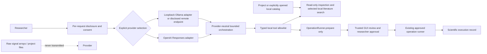

# NeuroScope AI Assistant Design

## Capabilities and status

The assistant includes a provider-backed chat panel, validated local tools, typed operation proposals, and versioned scientific specialization profiles. Profiles guide terminology and methodological caution without changing model weights or the trusted execution boundary. The GUI provides electrophysiology, general biological signals, neural dynamics/modeling, and scientific statistics profiles. Task 21 adds a local persistent literature library and lexical retrieval tool; it does not fine-tune the model or add scientific execution authority. See [Scientific Knowledge Engine](docs/SCIENTIFIC_KNOWLEDGE_ENGINE.md) and [Local Scientific Literature Library](docs/SCIENTIFIC_LITERATURE_LIBRARY.md).

## Architecture and interaction

Keep provider adapters separate from orchestration and the scientific engine. `assistant/contracts.py` contains provider-neutral messages, tool calls, schemas, proposals, usage and results. `assistant/providers.py` implements the optional OpenAI Responses adapter; `assistant/ollama_provider.py` implements Ollama's local HTTP chat adapter. `assistant/orchestration.py` bounds tool rounds/calls, rejects duplicate tool requests, and dispatches calls to `assistant/tools.py`, whose fixed allowlist exposes metadata/history reads and operation preparation. Tools do not expose execution, approval, raw-sample reads, filesystem access, or artifact mutation. Operation preparation validates through the existing registry and runner; only the desktop's researcher approval UI can hand the prepared token to that runner.

Assistant operation proposals are in-memory, typed, and bound to exact runner snapshots. They become stale when the active dataset registration, metadata, project, or application generation changes. A chat “yes” is never an approval. Prepared proposals state explicitly that they have not executed. Approved execution and its scientific provenance are written through the existing runner and project history; conversation messages are not stored as scientific decisions or project provenance.

Provider and model-discovery calls run on Qt workers. Each chat send shows the categories included: chat, operation schemas, active profile guidance, and any metadata/history/tool results requested by the model. For external providers, a fresh consent dialog names every selected assistant-visible document whose retrieved passage may be transmitted. The allowlist is per request and not persisted; changing providers does not reuse it. Unchecked documents are excluded before tool results are returned. Loopback Ollama runs locally and does not route through OpenAI. A non-loopback Ollama endpoint is treated as remote and requires endpoint disclosure plus per-request consent. OpenAI requests use Responses `store=false`; this disables application-state storage, not all provider processing or possible abuse-monitoring retention. Review [OpenAI data controls](https://platform.openai.com/docs/guides/your-data). Chat/tool content receives best-effort path and credential redaction. Raw arrays, source files, full PDFs and local library paths are not sent by the literature tool. Cancellation is cooperative: late GUI results are discarded, while an in-flight local or remote HTTP call may continue until timeout.

Every composable scientific operation continues to declare its own inputs, metadata, parameters, outputs, warnings, provenance and prerequisites. The assistant does not add an alternate operation engine. In the visual laboratory, users can adjust parameters, compare configurations, inspect intermediate results and discuss changes with the assistant; provide immediate feedback where computationally feasible. Never run arbitrary model-generated code against user data.

For large recordings, consider segmented visualization and lazy loading where appropriate. Profile representative workloads before choosing optimizations; reuse unaffected intermediate results when dependencies and parameters remain valid.

Future generated modules require defined schemas, synthetic tests, documentation, review, explicit approval, versioning and controlled execution before registration.

## Structured project memory

Project persistence now stores dataset/profile context, execution records and artifacts, and versioned pipeline definitions/run state. Compatible history can be restored without rerunning analyses; session references and approvals are not revived. This supports project reopening and reproducible review, but it is not yet a complete scientific decision log: the current dataset profile is not a versioned metadata-decision history, and rationale, rejected alternatives, and unresolved questions are not consistently represented as authoritative structured records. Keep these records distinct from chat history as that capability is developed.

Future caching keys should include inputs, metadata, operation graph, parameters, versions and seed. Invalidate dependent results only, preserve prior outputs, and mark stale results clearly.

## Approval, offline use and privacy

Autonomy is “propose, explain, wait for approval.” Approval is required before executing a new analysis, changing a pipeline/parameters, replacing results, or adding generated modules. Read-only inspection and proposals may be automatic. Missing scientific metadata must be requested, never invented.

Ordinary loading, visualization, analysis and persistence work offline. The assistant supports explicitly selected OpenAI or Ollama providers. Raw data remain local by default. Before OpenAI or non-loopback Ollama requests, disclose context and obtain per-request consent. Loopback Ollama requests remain on the configured local service. Never transmit arrays automatically or log credentials.

## Repository mapping and open decisions

`analysis/registry.py` stores typed operation definitions and is independent of Qt. `memory/project_store.py` persists dataset profiles, JSON execution history, artifacts, pipeline revisions and pipeline-run snapshots. It does not store assistant conversations or a complete versioned scientific decision log; cache reuse is not an automatic replay guarantee. For OpenAI, configure `OPENAI_API_KEY` and `NEUROSCOPE_OPENAI_MODEL`; install `.[ai]` only when using that provider. For Ollama, install/start Ollama manually, select an installed tool-capable model in the GUI, and optionally configure `NEUROSCOPE_OLLAMA_HOST`, `NEUROSCOPE_OLLAMA_MODEL`, `NEUROSCOPE_OLLAMA_TIMEOUT_S`, and `NEUROSCOPE_OLLAMA_MAX_OUTPUT_TOKENS`. Ollama model lists use `/api/tags`; selected-model tool support is checked through `/api/show` and must be explicitly reported. Chat uses `/api/chat` with only NeuroScope's allowlisted function schemas. The documented Qwen3 tags and setup commands are in `docs/ASSISTANT_EVALUATION.md`; the GUI never pulls them. The provider selector, host and model are stored as non-secret application preferences; API credentials are not read from or written to project files. If the selected provider is unavailable, the assistant reports that state and does not fall back. Scientific loading and operations continue locally. `assistant/client.py` remains only as a compatibility shim and rejects direct calls that would bypass consent and tool validation.

To add a provider, implement the `Provider.respond` protocol and map neutral messages, schemas, tool calls, errors, timeout and cancellation behavior without importing scientific algorithms. Tool dispatch must remain allowlisted and typed. To add a profile, use the versioned `ScientificProfile` contract; do not add execution privileges to profile content. Future scientific methods require independent operation identities, contracts, tests, provenance, researcher review and explicit approval; providers may propose them but may not execute generated code. See `docs/ASSISTANT_EVALUATION.md` for application-enforced assistant checks and `docs/SCIENTIFIC_KNOWLEDGE_ENGINE.md` for the expert-criterion benchmark and paired profile comparison.

Open decisions include future provider adapters, generated-code sandboxing, plugin trust and cache format. This implementation does not make autonomous-discovery or parameter-optimization claims. The scientific engine remains provider-independent because operation definitions, typed schemas, validation, approval, execution and provenance are implemented without importing assistant/provider modules; a provider can suggest a typed request but cannot run the engine.

## Trust boundary

Both provider adapters receive only the local function schemas. Neither enables web search, computer use, shell, code execution, or arbitrary tools. Every returned function name/argument payload is checked by the same local allowlist and typed validation. Tool results return as data and are treated as untrusted context on the next model turn. Ollama models without an explicit `tools` capability are not used for assistant requests.

## Local tool schemas

| Tool | Typed arguments | Effect |
|---|---|---|
| `get_current_dataset_summary` | Empty object | Read dimensions/identity and the currently selected safe `DataReference`; does not read samples. |
| `get_metadata_status` | Empty object | Read metadata values and confirmed/inferred/unknown status. |
| `list_available_operations` | Empty object | List registry definitions and versions. |
| `describe_operation` | `operation_id`, optional `version` | Read registered input/parameter/output schema and scientific requirements. |
| `list_project_executions` | Empty object | Return compact summaries from the active project. |
| `get_execution_summary` | `execution_id` | Return one compact, path-scrubbed execution summary. |
| `prepare_scientific_operation` | `operation_id`, `operation_version`, typed `input_data`, typed `parameters` | Call existing `OperationRunner.prepare`; never approves or executes. |
| `search_local_scientific_library` | `query`, bounded `limit` | Search only active researcher-selected libraries and documents explicitly marked assistant-visible; returns exact passage text and publication/access provenance. |

The current data reference exposes only the active dataset identity, selected channel indices, and half-open current navigation interval so a proposal can refer to a valid source. It is session-scoped, not an arbitrary path. A tool result may contain untrusted notes/warnings; only a typed local operation contract decides whether the proposal is valid.

## Literature evidence boundaries

Libraries have core, personal, laboratory, or project scope labels. These are local organization/visibility boundaries, not authentication, encryption, or network access control. Project libraries remain isolated by project. A separately opened catalog is an explicit researcher action and is reset when another project opens. The model cannot select or broaden the corpus; it searches only libraries active in the trusted UI and their assistant-visible documents.

Document text is untrusted input. The assistant must distinguish retrieved evidence from general knowledge, interpretation, hypothesis and uncertainty; cite only returned document/passage IDs; label abstract-only evidence; and show **“Preprint — not peer reviewed.”** Retrieval scores are relevance, not truth. It must not claim to have read unselected corpora or infer peer review from a DOI.

For OpenAI or remote Ollama, each request requires fresh consent for individually named documents before excerpts can be sent. Consent does not persist across requests/providers. Loopback Ollama keeps retrieval and inference local. NeuroScope Knowledge Packs are validated, versioned local archives; imports remain inactive and assistant-hidden until a researcher selects the pack library and enables each document. Reference-only is the default export, while source payload export requires separate redistribution and private-content confirmations. Pack contents cannot add tools, execute code, or approve operations. See [SCIENTIFIC_LITERATURE_LIBRARY.md](docs/SCIENTIFIC_LITERATURE_LIBRARY.md) and [NEUROSCOPE_KNOWLEDGE_PACKS.md](docs/NEUROSCOPE_KNOWLEDGE_PACKS.md).
