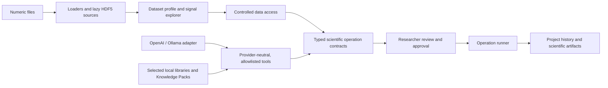

# NeuroScope AI

NeuroScope AI is a Python/PySide6 desktop research prototype for inspecting biological signals and running reproducible analyses. Scientific operations are provider-independent. The optional assistant can inspect allowed scientific context and prepare typed proposals; a researcher must approve analyses through the application.

> **Prototype status:** the software is tested, but those tests do not establish biological validity, clinical suitability, or model reliability. This is not a released or independently validated analysis package.

## Implemented

- **Data and exploration:** numeric `.npy`, `.csv`, `.txt`, classic MATLAB `.mat`, and numeric MATLAB v7.3/HDF5 datasets. Text loader options include delimiter, header, and skipped rows. Multiple MATLAB variables require explicit selection. Numeric v7.3 datasets can stay lazy for bounded channel/window reads; classic MAT and simple loader calls materialize arrays. Special MATLAB objects such as cells and structs are unsupported. For 2D data, the researcher confirms which axis represents channels. Empty, nonnumeric, and non-finite data are rejected; lazy sources validate requested windows as they are read.
- **Metadata and visualization:** sample indices are the base coordinate. Sampling rate, units, signal kind, and filtering information are not invented; MATLAB attributes may be inferred, while time conversion requires confirmed sampling rate. The explorer navigates channels and sample windows and uses a visualization-only min/max envelope for dense plots.
- **Scientific operations:** two intentionally distinct spike detectors (negative-going median-centered MAD and signed peak detection), waveform extraction and summaries, ISI metrics, the MATLAB-derived `calcMUA` method, and equal-channel averaging of compatible MUAtraces. Synthetic recordings and polarity-aware ground-truth evaluation are available. This application does not sort spikes into neurons.
- **Approval, projects, and pipelines:** typed operation contracts use prepare → review → approve → execute. Project files persist scientific execution history and artifacts. The pipeline workspace saves reusable, validated operation graphs; each operation still requires explicit approval.
- **Scientific assistant:** a provider-neutral tool layer supports optional OpenAI and local Ollama chat, read-only context tools, operation discovery, and typed proposals. The model has no approval or execution tool and cannot run generated code. Missing providers do not block local scientific workflows.
- **Literature:** consent-gated Europe PMC metadata search and Crossref DOI verification are separate from the assistant tool allowlist. Local libraries support researcher-defined core, personal, laboratory, and project scopes, selected-document visibility, deterministic lexical passage search, and exact passage provenance. Versioned Knowledge Packs can be exported reference-only by default; importing a pack leaves it inactive and its documents assistant-hidden.

The listed capabilities are implemented in the current source tree. The repository's working-tree changes still need review and deliberate inclusion before they are part of a public GitHub revision.

## Scientific method and implementation provenance

### calcMUA

The calcMUA approach implemented in NeuroScope AI is based on a scientific method developed by Dr. Cecilia Herbert. Fiamma Liz Leites independently implemented this method in MATLAB as `calcmua_verFi.m`, using Herbert's algorithm as a methodological reference. NeuroScope AI provides a separate Python implementation based on Leites' MATLAB implementation.

The calculation is also used in a collaborative preprint on autoencoder-based analysis of neural activity, coauthored by Herbert and Leites. The verified reference is: Leites, F. L., Herbert, C. T., Boari, S., Cignoli, F. I., Mindlin, G. B., & Amador, A. (2026). *Low-dimensional neural dynamics underlying rhythmic vocal behavior in songbirds*. Preprint. [https://doi.org/10.64898/2026.03.28.715006](https://doi.org/10.64898/2026.03.28.715006). This preprint is scientific context for the calculation; it is not presented as publication of Herbert's original source code or as the first introduction of the method. Per researcher-provided information, that original source code is not publicly available. This acknowledgment recognizes the method's provenance and does not imply that Dr. Herbert authored, developed, contributed code to, or endorses NeuroScope AI.

Numerical parity between the NeuroScope Python implementation and MATLAB-generated reference outputs has not been established.

### Signed-peak spike detection

The original `spike_detection.py` reference implementation was authored by Fiamma Liz Leites. NeuroScope's signed-peak operation is a separate implementation based on that method. The method attribution does not imply authorship or endorsement by a collaborator.

## Architecture



Assistant tools can inspect permitted metadata and prepare an operation. Only the trusted application and operation runner can continue after researcher approval. Raw recordings are not exposed as assistant tools. External-provider requests require consent; any retrieved private document passage requires separate per-document consent. Local library scopes organize data but do not implement authentication, encryption, or collaborative access control.

## Install, run, and test

Python 3.10 or newer is declared in `pyproject.toml`. From the repository root:

**Windows PowerShell**

```powershell
py -m venv .venv
.\.venv\Scripts\Activate.ps1
python -m pip install -e ".[dev]"
neuroscope
python -m pytest -p no:cacheprovider
python -m ruff check --no-cache src tests
```

**macOS/Linux**

```bash
python3 -m venv .venv
source .venv/bin/activate
python -m pip install -e ".[dev]"
neuroscope
python -m pytest -p no:cacheprovider
python -m ruff check --no-cache src tests
```

The `dev` extra provides pytest and Ruff. The test suite uses synthetic fixtures and fake providers; it does not require API credentials or make live service calls. If Windows encounters temporary-path length limits, pass a short temporary directory with pytest's `--basetemp` option.

The assistant is optional. Install `.[ai]` only for OpenAI; set `OPENAI_API_KEY` and `NEUROSCOPE_OPENAI_MODEL` in the launching process environment. Do not put credentials in project files. Ollama must be installed and started separately; NeuroScope does not install Ollama or download model weights. PDF extraction requires the optional `.[literature]` extra (`pypdf`) and does not provide OCR.

For offline assistant evaluations, see [docs/ASSISTANT_EVALUATION.md](docs/ASSISTANT_EVALUATION.md). For storage and recovery, see [docs/PROJECT_PERSISTENCE.md](docs/PROJECT_PERSISTENCE.md); for pipelines, see [docs/SCIENTIFIC_PIPELINES.md](docs/SCIENTIFIC_PIPELINES.md). Literature details are in [docs/SCIENTIFIC_LITERATURE_LIBRARY.md](docs/SCIENTIFIC_LITERATURE_LIBRARY.md), [docs/NEUROSCOPE_KNOWLEDGE_PACKS.md](docs/NEUROSCOPE_KNOWLEDGE_PACKS.md), and [docs/SCIENTIFIC_KNOWLEDGE_ENGINE.md](docs/SCIENTIFIC_KNOWLEDGE_ENGINE.md).

## Evaluation and validation boundaries

Automated tests check data validation, deterministic algorithms, approval enforcement, persistence, provenance, synthetic ground-truth metrics, and assistant privacy/tool invariants. Synthetic metrics are computational checks, not biological performance estimates. Assistant evaluations use deterministic fixtures and fake providers by default; optional live-provider evaluations are separately invoked and can incur charges. The scientific benchmark rubric requires human assessment and is not an independent expert validation.

No genuine MATLAB-generated v7.3 recording or private research dataset is included in this repository. MATLAB v7.3 tests use synthetic HDF5 fixtures. No live model evaluation, clinical validation, or general biological validation is claimed.

## Known limitations and not implemented

- No spike sorting, PSTH, broad preprocessing/filtering suite, multimodal synchronization, or advanced population analyses.
- No OCR, full-text download, embeddings/vector RAG, public Knowledge Pack marketplace, network synchronization, or multi-user library permissions.
- PDF extraction depends on optional `pypdf`; scientific layout, equations, and tables may not extract faithfully.
- Provider responses can be incorrect. Consent, typed contracts, local validation, and researcher approval constrain application actions but do not guarantee answer quality.
- OpenAI use may incur charges and is subject to provider retention policies. Local Ollama is offline only when configured to a loopback service.
- No MATLAB parity claim is made for `calcMUA` without MATLAB reference outputs. Synthetic validation does not establish biological validity.

The root MIT license applies only to NeuroScope-owned material by Fiamma Liz Leites; third-party or collaborator-owned material is excluded and remains subject to its own terms. File-level authorship and redistribution rights still require final review before publication. Preserve third-party notices. A project license does not replace dependency obligations; in particular, review PySide6's applicable LGPL/GPL or commercial distribution terms before bundling or distributing the application. Do not treat this source-only prototype review as legal advice.
