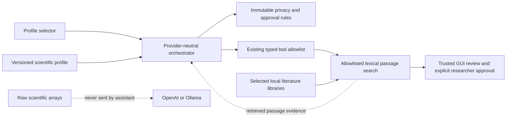

# Scientific Knowledge Engine

## Scope and trust boundary

The Scientific Knowledge Engine is a provider-independent specialization layer. It supplies versioned scientific guidance to the existing assistant; it does not train or change model weights, add analysis tools, read signal arrays, confirm metadata, approve proposals, or execute operations. OpenAI and Ollama receive the same bounded profile instructions and the same locally allowlisted tool schemas. Existing application security, consent, typed validation, and trusted researcher approval remain authoritative.



## Profiles

`assistant/profiles.py` defines validated profiles with stable namespaced IDs, semantic versions, domains, terminology, methodological principles, interpretation constraints, evidence policy, tool guidance, evaluation-suite IDs, and future collection references. The explicit registry can keep multiple versions and resolves the newest version when only an ID is requested. The GUI stores the selected profile ID as a user preference and displays its version and description. The default is **Electrophysiology and Spike Analysis**; **General Biological Signals** is the baseline in paired comparisons. Neural Dynamics and Computational Modeling and Scientific Statistics and Validation are also available.

Profiles are compact, bounded prompt context for small local models. They do not alter provider selection, permissions, operation parameters, project metadata, project history, or model weights. Profile text is presented as scientific guidance and the immutable application boundary is appended after it. Local policy remains enforced in the tool service and operation runner even if a model ignores prompt guidance.

The electrophysiology profile distinguishes spike detection from spike sorting; channel/electrode identity from neuron identity; MUA definitions; detector noise and threshold conventions; waveform/ISI evidence from cell identity; and synthetic from biological validation. It avoids universal thresholds or bandwidths and treats missing sample rate, units, filter history, and time origin as unknown.

## Evidence and citations

`EvidenceSource`, `RetrievedPassage`, `EvidenceBundle`, and `EvidenceClaim` define the provider-neutral evidence contract. The local library adds typed document, passage and retrieval records with stable IDs, fingerprints, page/character ranges, retrieval version/time and provenance. Relevance is search ranking, not scientific confidence. Citations must resolve to actual returned document and passage IDs. General knowledge, NeuroScope contract facts, retrieved evidence, hypotheses, and unknown claims remain distinct. Versioned `.nskpack` Knowledge Packs can preserve selected references, authorized document payloads and researcher-authored methodological resources; imports become separate inactive libraries and retain pack/version provenance in retrieval results. Pack hashes provide integrity checking, not author authentication. See [SCIENTIFIC_LITERATURE_LIBRARY.md](SCIENTIFIC_LITERATURE_LIBRARY.md) for local corpus controls and [NEUROSCOPE_KNOWLEDGE_PACKS.md](NEUROSCOPE_KNOWLEDGE_PACKS.md) for the package contract and safeguards.

## Literature discovery interface

`assistant/literature.py` adds provider-independent literature consent and result contracts. `LiteratureSearchService` requires a fresh typed consent decision for the exact researcher-entered query, including confirmation that it contains no private project data, recordings, unpublished notes, or confidential research. The disclosure names the external destination and exact query. Only that query is sent; no dataset/profile/project context is attached. Consent is query- and provider-bound and signed by the in-process gate. Literature providers are not added to the assistant's tool allowlist, so a model cannot initiate a search. The assistant remains usable offline.

The minimal `EuropePMCProvider` performs read-only metadata/abstract search through the Europe PMC REST endpoint, with bounded results, timeout, a conservative client-side per-instance request interval, and no retries. It does not fetch full text. Europe PMC entries explicitly marked as preprints are classified `preprint_not_peer_reviewed` and expose the prominent warning **“Preprint — not peer reviewed.”** Journal-article record type alone does not prove peer review, so review status remains unverified unless an explicit review-status source is provided. A source-provided related-record field is preserved when present; otherwise no relationship is invented.

`CrossrefDOIVerifier` performs an explicit, consent-gated DOI lookup and marks the identifier as verified by Crossref while leaving peer-review status unverified. Source-provided Crossref relation metadata is surfaced as a possible linked publication version. Each linked record warns that scientific identity has not been established; users must compare versions. A separate Crossref DOI check can verify the linked identifier and retrieve its metadata. Europe PMC preprint records are supported when indexed with explicit preprint status; a standalone bioRxiv API adapter is deferred. `manual_google_scholar_link()` only constructs a user-opened search URL; there is no Scholar scraping backend.

Results preserve source URLs, retrieval times, source IDs, provider/version, query fingerprint, identifiers and their verification provenance, publication/review state, abstract-versus-full-text level, full-text availability, source-reported license text, and unknown states. Abstracts are labeled abstract-only; OA full-text links are not fetched. An available link or license label is not itself permission to copy, index, or redistribute. Respect source terms, copyright, and access controls. Task 21 separately supports researcher-imported local documents and explicitly selected literature metadata/abstract records. Its retriever is not allowed to initiate online search. Deterministic tests use injected fake transports and local synthetic documents; no external literature request was made during implementation.

## Scientific competence benchmark

`assistant/scientific_benchmark.py` provides versioned suite `neuroscope.scientific-competence` v1.0.0 with 37 synthetic-context cases. Coverage includes sorting/detection distinctions (including the misconception that sorting necessarily needs multiple channels), unsorted MUA, metadata states, estimator and threshold semantics, waveforms, ISIs, artifacts, KDE bandwidth, MUA modes and channel averaging, temporal correlation/lag/causality, sampling-grid mismatch, hierarchy/pseudoreplication, surrogate controls, multiplicity, unsupported citations/certainty, incompatible methods, and approval boundaries.

Each case stores its question, supplied context, expected and forbidden assertions, required uncertainty/clarification, expected tool behavior, and a six-dimension rubric: scientific accuracy, calibration, tool use, metadata fidelity, unsupported assertions, and safety/approval compliance. Scoring requires a human reviewer to rate each criterion from 0 to 2 and mark forbidden assertions and uncertainty/tool compliance. It does not compare text similarity or rely on keywords. The initial criteria are implementation-authored and **pending researcher/subject-matter review**; they must not be represented as already externally expert-reviewed. A passing rubric score is review evidence, not proof of general model reliability.

The paired comparison runner sends the same case and tool factory through the same provider object/model for General Biological Signals and Electrophysiology and Spike Analysis. It records profile IDs/versions, model, answers, sanitized tool calls/results, usage and latency. Responses remain unreviewed until manually scored; the report does not assert that specialization is superior. Offline fixture checks never call a provider.

## Commands

Validate and export the case catalog without inference or network access:

```powershell
# Run from the repository root.
$benchmarkReport = Join-Path $env:TEMP 'ns20-benchmark.json'
.venv\Scripts\python.exe -c "from neuroscope.assistant.evaluation import run_offline_scientific_benchmark; print(run_offline_scientific_benchmark(r'$benchmarkReport'))"
```

Run an explicitly selected local Ollama paired comparison using synthetic application state only:

```powershell
# Run from the repository root.
.venv\Scripts\python.exe -m neuroscope.assistant.evaluation --scientific-benchmark --local --model qwen3:4b --max-requests 10 --max-tokens 2000 --timeout 180 --output "$env:TEMP\ns20-profile-comparison.json"
```

The local command does not run in pytest, download models, or use project recordings. Request and token budgets are explicit. A non-loopback Ollama endpoint additionally requires `--authorize-remote`; remote operators have their own data handling. The report records paired answers and tool activity but marks them `manual_expert_review_required`. Live inference can vary across runs and versions. Do not infer scientific competence from mocked tests or a small local smoke test.

## Adding a specialization

Add a bounded `ScientificProfile` definition with a stable ID and incremented version when its scientific content changes. Include precise scope, methodological distinctions, uncertainty/evidence rules, and applicable suite IDs. Do not encode privileges or arbitrary tool names in a profile. Add benchmark cases and tests for consequential claims. Preserve the immutable privacy/approval rules and run the same paired cases against the baseline profile. Researcher review should approve benchmark criteria and any claims about comparative performance.

## Limitations

Profiles are curated prompt guidance and local retrieval is a lexical baseline; a language model may still err. There is no OCR, embedding model, vector retrieval, reranker, full-text acquisition, or automated online search. PDF equations, tables and layout may be degraded. Library scopes are local organization boundaries, not user authentication, encryption, or collaborative access control. The synthetic evaluation cases establish application invariants only; they do not establish model answer quality or improved accuracy. Retrieval relevance must not be reported as truth confidence. Evaluate grounding separately from language quality and preserve offline behavior.

Fine-tuning, if considered later, should be evaluated against held-out expert-reviewed cases, baseline and profile-prompt comparisons, safety regressions, metadata fidelity, and calibration. This task makes no fine-tuning or scientific-validity claim.
